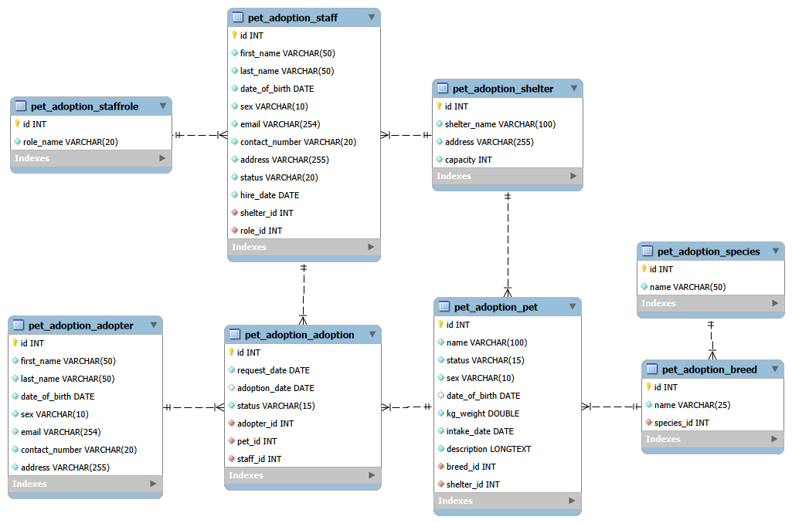
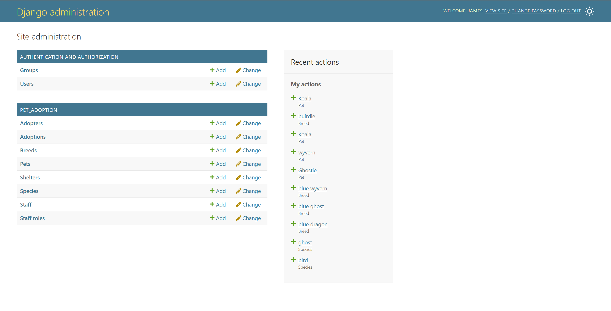
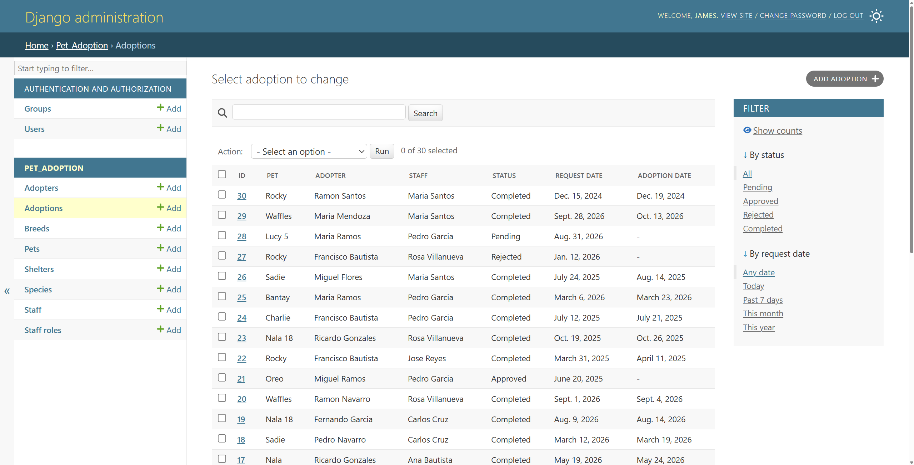
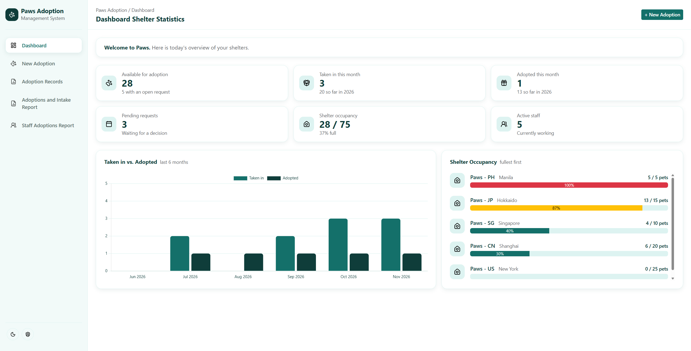
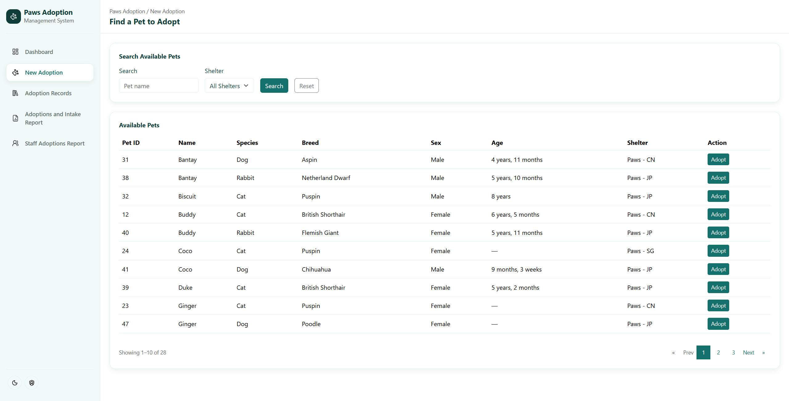
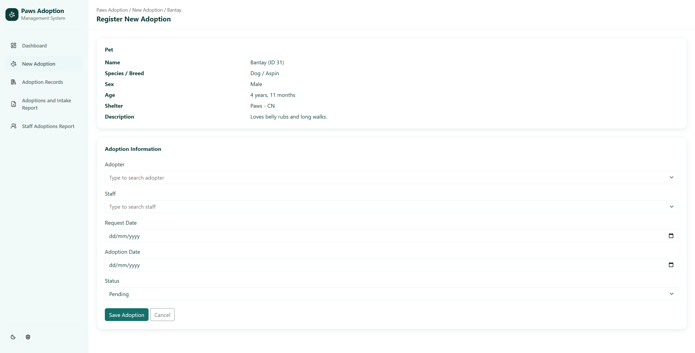
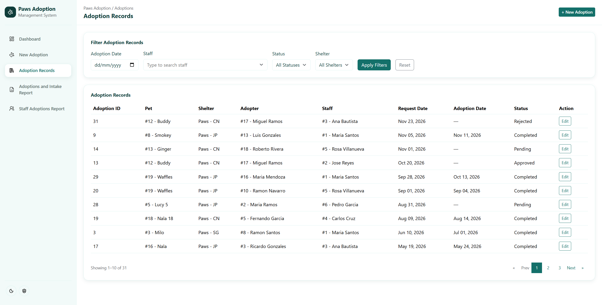
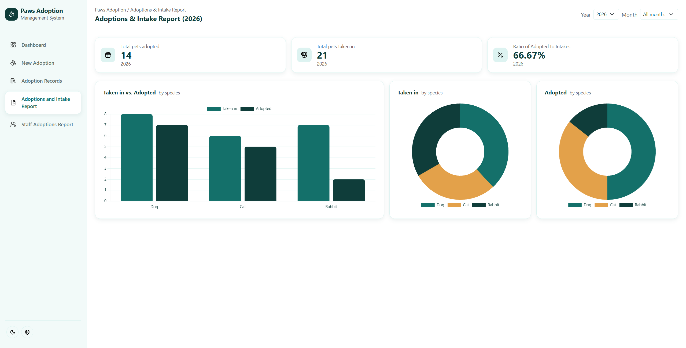
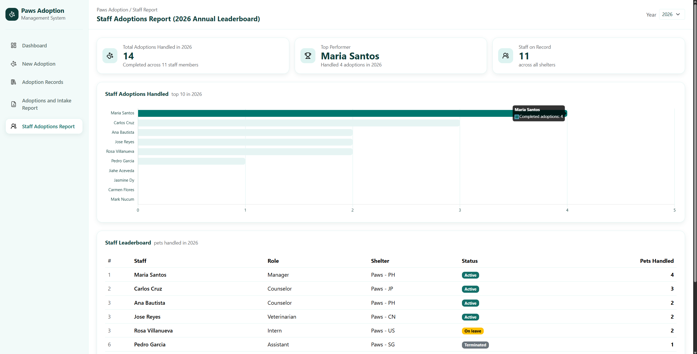
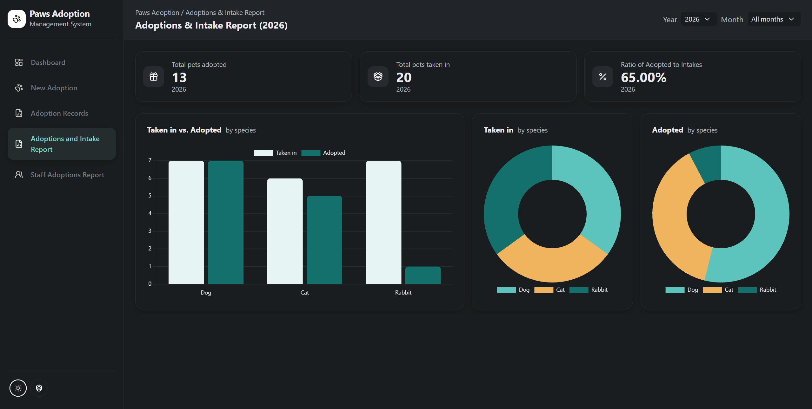

# Paws 
> A Pet Adoption Management System

**Paws** helps shelters manage their pets, staff, adopters, and adoption requests in one place. It provides a centralized platform for tracking pet records, managing adoption processes, maintaining staff and adopter information, and generating reports on shelter activities.

<!-- Yo guys let's add an image here once we're done lol -->


## Table of Contents

- [Paw Patrol Members](#paw-patrol-members)
- [Features](#features)
- [Tech Stack](#tech-stack)
- [Database Design (ERD)](#database-design)
- [Getting Started](#getting-started)
- [Project Structure](#project-structure)
- [Screenshots](#screenshots)
- [References](#references)


## Paw Patrol Members

**Section & Group Number:** S40K - 03  
**School:** De La Salle University Manila  
**Course:** CCINFOM | A.Y. 2026 - 2027 Term 1  
**Instructor:** Dr. Payawal, Bryan O’Nomerp  

- Aceveda, Jiahe     
- Dy, Jasmine        
- Nucum, Mark        
- Pielago, James C. 

## Features

### Django Admin Panel

Managed records:
- Pets
- Breeds and Species
- Adopters
- Staff
- Staff Roles
- Adoptions
- Shelters

Each of the main records supports the standard record management functions:

- Create a new record.
- Read/View an existing record.
- Update an existing record.
- Delete an existing record.
- List records, searchable and filterable by a set of fields.

### Dashboard
- KPI cards: pets available for adoption, pets taken in this month, pets adopted this month, pending requests, shelter occupancy, and active staff.
- Per-shelter progress bars showing pets in the shelter versus capacity.
- A Chart.js bar chart of pets taken in versus adopted over the last 6 months.

### New Adoption
- Paginated list of all available pets, filterable by shelter.
- Adopt a pet from the list, leading to an adoption form page.
- Form to register an adoption by adopter (searchable drop-down list), staff member (searchable drop-down list), request date, adoption date (optional), and status.
- Only pets currently in a shelter can be selected, and a pet with an active (approved) request is rejected.
- If there is an existing active request (pending or approved), a duplicate adoption cannot be made, unless the previous request was rejected (re-applying) or completed (the pet was returned).
- Only active staff can be assigned.
- Completing an adoption automatically marks the pet as adopted.

### Adoptions
- Paginated list of all adoption records, filterable by status, staff (searchable drop-down list), and adoption date.
- Edit an adoption's status and adoption date. The pet's status updates with it: completed means adopted, anything else returns the pet to in-shelter.

### Reports
- **Adoptions and Intake Report:** pets adopted versus taken in, grouped by species, for a chosen year and month (or all months).
-  **Staff Adoptions Report:** staff ranked by the number of adoptions they successfully handled in a chosen year, with a top-10 chart.

### Other
- Light and dark theme toggle.


## Tech Stack

| Layer                 | Technology                     | 
|-----------------------|--------------------------------|
| Language              | Python 3.12+                   |  
| Web Framework         | Django 6.1                     |
| Database              | MySQL 8.4+                     |
| Charts                | Chart.js (via CDN)             |
| Records Management UI | Django Admin                   |
| Custom UI             | Bootstrap 5 (via CDN) + Custom CSS / JS  |
| Searchable Drop Downs | Tom Select 2.3.1 (via CDN)     |
| Config                | python-dotenv                  |
| Environment           | venv                           | 

## Database Design
| Table      | Fields                                                                                                                                                                             |
|------------|----------------------------------------------------------------------------------------------------------------------------------------------------------------------------------- |
| Staff Role | id (PK), role name                                                                                                                                                                 |
| Shelter    | id (PK), shelter name, address, capacity                                                                                                                                           |
| Staff      | id (PK), first name, last name, date of birth, sex (male, female), email, contact number, address, status (active, on-leave, terminated), hire date, shelter id (FK), role id (FK) |
| Adopter    | id (PK), first name, last name, date of birth, sex (male, female), email, contact number, address                                                                                  |
| Adoption   | id (PK), request date, adoption date (nullable), status (pending, approved, rejected, completed), adopter id (FK), pet id (FK), staff id (FK)                                      |
| Pet        | id (PK), name, status (in-shelter, adopted, deceased), sex (male, female), date of birth, kg weight, intake date, description (nullable), breed id (FK), shelter id (FK)           |
| Breed      | id (PK), name, species id (FK)                                                                                                                                                     |
| Species    | id (PK), name                                                                                                                                                                      |
### Entity Relationship Diagram of the DB (Django Excluded):


## Getting Started
Follow the guide step-by-step.

### Prerequisites

- [Python 3.12 or newer](https://www.python.org/downloads/)
- [MySQL 8.4 or newer](https://dev.mysql.com/downloads/mysql/)
- [Git](https://git-scm.com/downloads)

### 1. Clone the repository
Use this repository's URL.

```bash
# (Optional) Change to preferred folder
cd [your_folder]

# Clone
git clone [URL]

# Change to the repository folder
cd CCINFOM-S40K-03-Pet_Adoption_Management_System
```

### 2. Create and activate a virtual environment
Creation is only once; activation is for every use.
```bash
# Create venv
python -m venv venv

# Activate (Windows)
venv\Scripts\activate

# Activate (macOS / Linux)
source venv/bin/activate
```

### 3. Install dependencies
Once your `venv` is activated, install the dependencies.
```bash
# Change directory
cd pet_adoption_system

# Then run:
pip install -r requirements.txt
```

### 4. Set up environment variables
Copy the example file to create your own `.env` (same folder as `manage.py`):

```bash
# Windows
copy .env.example .env

# macOS / Linux
cp .env.example .env
```

Then open `.env` and fill in your own values. **Never commit this file.** It should already be in your `.gitignore`.
```py
SECRET_KEY=your-own/generated-key # Change for actual use
DJANGO_DEBUG=True
DJANGO_ALLOWED_HOSTS=

DB_ENGINE=django.db.backends.mysql
DB_NAME=pet_adoption_db
DB_USER=petuser
DB_PASSWORD=your_mysql_password # Change to actual password
DB_HOST=127.0.0.1
DB_PORT=3306
```

Make your own `SECRET_KEY` or generate one:
```bash
python -c "from django.core.management.utils import get_random_secret_key; print(get_random_secret_key())"
```

> Copy the key into your `.env`. No quotes around values and no spaces around the `=` in `.env`.

### 5. Set up the database
Log in your MySQL account (ensure your MySQL is in your Environmental Variables Path):
```bash
mysql -u root -p
```

Then run to create the database in MySQL:
> Change to your password
```sql
CREATE DATABASE IF NOT EXISTS pet_adoption_db CHARACTER SET utf8mb4 COLLATE utf8mb4_unicode_ci;
CREATE USER IF NOT EXISTS 'petuser'@'localhost'
IDENTIFIED BY 'your_password_here';
GRANT ALL PRIVILEGES ON pet_adoption_db.* TO 'petuser'@'localhost';
EXIT;
```

### 6. Run migrations
These allow us to let Django prepare the models and actually apply them into the MySQL db. 
Redo this to apply any change you made to the models. 
```bash
python manage.py makemigrations
python manage.py migrate
```

### 7. (Optional) Load sample data 
In CMD:
```bash
mysql -u root -p pet_adoption_db < seed_data.sql
```

### 8. Create an admin account

```bash
python manage.py createsuperuser
```

### 9. Run the development server

```bash
python manage.py runserver
```

Open [http://127.0.0.1:8000/](http://127.0.0.1:8000/) in your browser or whatever is your host in the terminal.


## Project Structure
Key folders and files of the project:
```
CCINFOM-S40K-03-Pet_Adoption_Management_System/
├── docs/                        # Proposal, ERD, and screenshots
└── pet_adoption_system/
    ├── manage.py
    ├── requirements.txt
    ├── .env.example             # Template for your own .env
    ├── seed_data.sql            # Optional sample data
    ├── pet_adoption_system/     # Django project (settings, root URLs)
    └── pet_adoption/            # Main app
        ├── models.py            # Database tables
        ├── admin.py             # Django Admin (record management)
        ├── views.py             # Dashboard, adoptions, and reports
        ├── urls.py
        ├── adoptions_intake_report.py  # Report 1 data builder
        ├── templates/           # base.html and page templates
        └── static/              # custom.css, JS (custom.js, charts.js), icons
```


## Screenshots
| Page                        | Screenshot                                                                  |
|-----------------------------|-----------------------------------------------------------------------------|
| Django Admin Panel          |   |  
| Dashboard                   |                                 |
| New Adoption                |                           |
| Adoptions                   |                          |
| Adoptions and Intake Report |  |
| Staff Adoptions Report      |       |
| Light                       |                                         |
| Dark                        |                                           |


## References
- *AmaneKai (n.d.). CCINFOM-DBAPP-SAMPLE. https://github.com/AmaneKai/CCINFOM-DBAPP-SAMPLE*
- *Bootstrap (n.d.). Bootstrap 5 Documentation. https://getbootstrap.com/docs/5.3/getting-started/introduction/*
- *Chart.js (n.d.). Chart.js Docs. https://www.chartjs.org/docs/latest/*
- *Django (n.d.). Django documentation. Django Project. https://docs.djangoproject.com/en/6.1/*
- *Lucide (n.d.). Lucide. https://lucide.dev/*
- *Tom Select (n.d.). Basic Examples. https://tom-select.js.org/examples/*